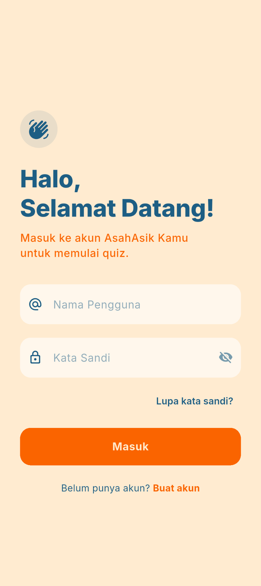
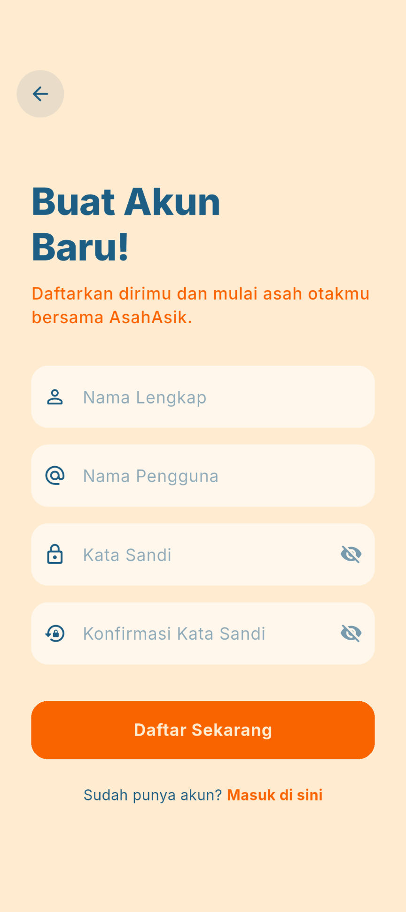
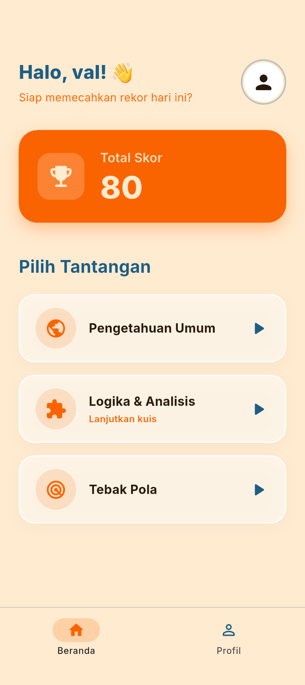
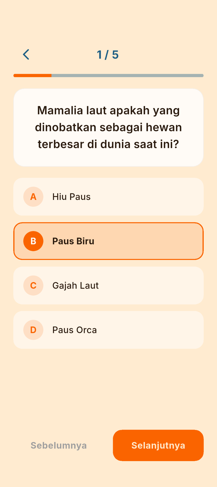
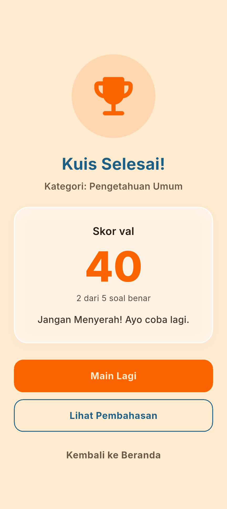
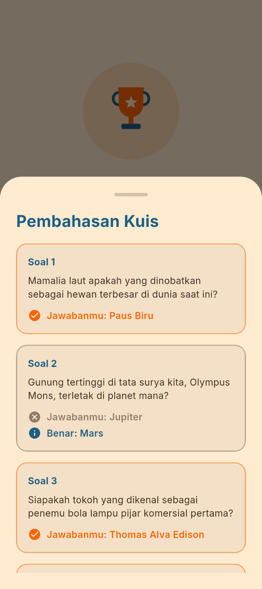
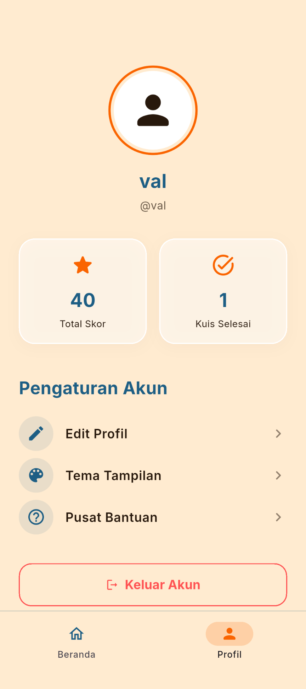
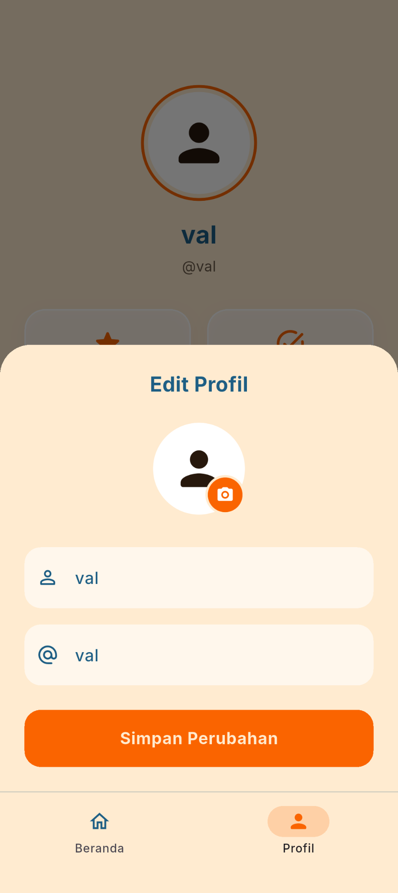
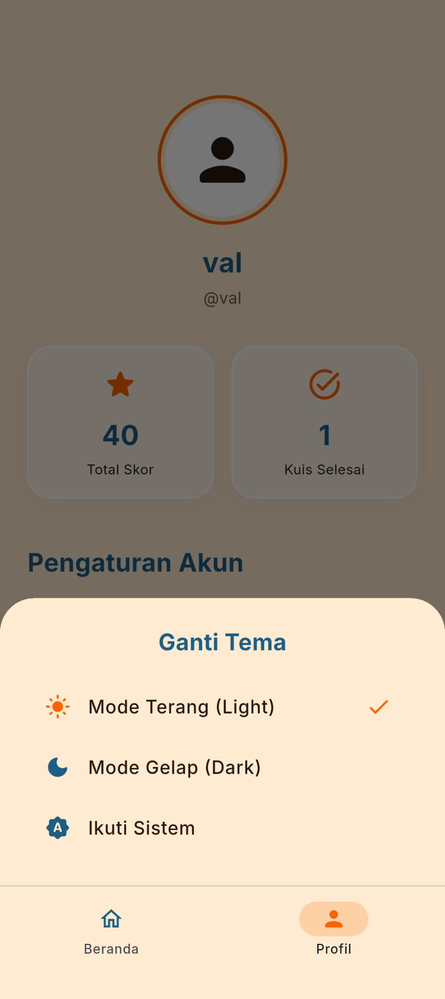

# AsahAsik
Aplikasi kuis pilihan ganda berbasis Flutter. Pengguna memasukkan nama, menjawab
serangkaian pertanyaan, lalu melihat skor akhir atas namanya.

## Identitas Mahasiswa
- Nama : Valmai Imtiyaz
- Nim : 241401135
- Lab : Pemrograman Mobile 6

## Informasi Aplikasi
- **Nama aplikasi:** AsahAsik
- **Deskripsi singkat:** AsahAsik adalah aplikasi kuis pilihan ganda dengan tiga
kategori (Pengetahuan Umum, Logika & Analisis, Tebak Pola). Data soal bersifat
lokal (tanpa database). Skor dihitung otomatis dan ditampilkan bersama nama
pengguna, lengkap dengan pembahasan tiap soal.

**Fitur:**
- Daftar akun dan masuk (validasi input, akun disimpan di memori, tanpa backend).
- Input nama pemain sebelum kuis dimulai, nama tampil pada skor akhir.
- 3 kategori kuis, masing-masing 5 soal pilihan ganda.
- Navigasi soal (Sebelumnya / Selanjutnya) dan indikator progres.
- Progres jawaban tidak hilang saat layar dirotasi, pindah halaman, atau
  keluar dari kuis lalu kembali (kartu kategori menampilkan "Lanjutkan kuis").
- Skor akhir (0-100), jumlah jawaban benar, dan menampilkan jawaban yang benar tiap soal.
- Total skor memakai skor terbaik per kategori, jumlah kuis selesai dihitung nyata.
- Profil terdapat ubah nama/username, ganti foto dari galeri.
- Dual-theme terdapat terang, gelap, atau ikuti sistem.
- Adaptive & responsive terdapat ukuran UI diukur dari lebar layar, konten dibatasi
  lebarnya di tablet/web, layout kuis berubah menjadi dua kolom di landscape.

### Dokumentasi
* Font Typography: [Inter by Google Fonts](https://fonts.google.com/specimen/Inter) (Regular, Medium, SemiBold, Bold, ExtraBold, Italic)
* Sumber Soal: Wikipedia, beberapa pertanyaan di modifikasi dari referensi (GauthMath, Scribd), SOALCAT, testbook 
* Icons: Material Icons bawaan Flutter.

### Mockup / Prototype
- Link Figma: https://www.figma.com/design/nruF86KragDbJPpHvYkwcT/Untitled?node-id=17-27&t=UmeFutrfMPIJDdt9-1

### Screenshot Aplikasi

| Sign In & Sign Up | Home Screen | Home Screen |
| :---: | :---: | :---: |
|   |  | .png) |

| Quiz Screen | Result Screen | Pembahasan (Pop-up) |
| :---: | :---: | :---: |
|  |  |  |

| Profile Screen | Edit Profile | Theme Selection |
| :---: | :---: | :---: |
|  |  |  .png) |
